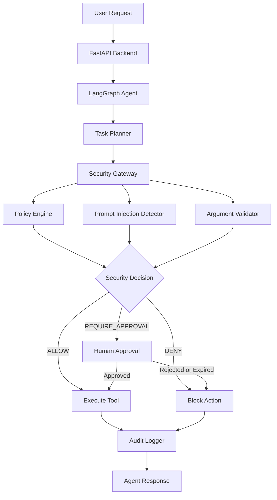

# 🛡️ AgentShield
### A Security Gateway for AI Agents and Tool-Calling Systems

**Securing AI agents against prompt injection, unauthorized tool usage, and unsafe actions — before execution.**

AgentShield is a security layer designed to protect AI-powered agents and tool-driven applications from malicious instructions and unauthorized operations. It evaluates every requested tool action through a centralized security gateway before allowing it to execute.

By combining policy-based access control, prompt-injection detection, argument validation, human approval workflows, and audit logging, AgentShield makes AI agent interactions safer, more controlled, and more transparent.

---

## 🚨 The Problem

AI agents are becoming increasingly capable of interacting with external tools, accessing documents, searching files, and performing actions on behalf of users.

However, these capabilities introduce security risks:

- **Prompt Injection:** Malicious instructions hidden inside documents or retrieved content can manipulate an AI agent.
- **Unauthorized Access:** Agents may attempt to access sensitive information without appropriate permissions.
- **Unsafe Tool Execution:** An agent could initiate actions that should require user authorization.
- **Lack of Accountability:** Without proper logging, it can be difficult to understand why an action was allowed or blocked.

Traditional AI applications often focus on what an agent can do rather than whether it should be allowed to do it.

## 💡 Our Solution

AgentShield introduces a dedicated security gateway between an AI agent and its tools.

Instead of executing every requested action directly, AgentShield evaluates it against security policies and returns one of three decisions:

| Decision | Meaning |
|---|---|
| `ALLOW` | The action is permitted and can execute. |
| `DENY` | The action violates security rules and is blocked. |
| `REQUIRE_APPROVAL` | The action requires explicit human authorization. |

**Core principle:** Every tool action must pass through the security gateway before execution.

---

## ✨ Key Features

### 1. Centralized Security Gateway
- Intercepts tool requests before execution.
- Applies security policies consistently.
- Prevents direct, uncontrolled tool execution.
- Fails closed when an action is unknown or unauthorized.

### 2. Prompt Injection Detection
- Detects suspicious instructions using pattern-based detection.
- Inspects retrieved document content before returning it to the AI agent.
- Blocks documents containing detected malicious instructions.
- Treats retrieved content as untrusted input.

### 3. Policy-Based Access Control
- Defines permissions for individual tools.
- Blocks unauthorized access to sensitive information.
- Restricts unknown tools and unsupported operations.
- Separates ordinary tool access from high-impact actions.

### 4. Human-in-the-Loop Approval
- Requires approval before external communication actions.
- Maintains pending approval requests.
- Supports approval and rejection.
- Implements approval expiry and one-time execution to prevent replay.

### 5. Argument Validation
- Validates tool names and arguments.
- Rejects missing, unexpected, incorrectly typed, empty, or excessively long arguments.
- Applies validation before tool execution.

### 6. Audit Logging
- Records security decisions and tool execution events.
- Stores audit information using SQLite.
- Helps trace why actions were allowed, denied, or sent for approval.

### 7. AI Agent Orchestration
- Uses LangGraph to coordinate the agent workflow.
- Uses Groq-powered language model inference.
- Separates task planning, security evaluation, and agent response generation.

---

## 🏗️ System Architecture



### Execution Workflow

1. The user submits a request.
2. The AI agent and planner identify the required operation.
3. The requested tool and its arguments are sent to the security gateway.
4. The gateway validates the request and evaluates its permissions.
5. Prompt-injection checks are applied where relevant.
6. The gateway returns `ALLOW`, `DENY`, or `REQUIRE_APPROVAL`.
7. Approved actions execute through controlled tool handlers.
8. The result and security decision are recorded in the audit log.

---

## 🧰 Technology Stack

| Technology | Purpose |
|---|---|
| Python | Core backend development |
| FastAPI | REST API development |
| Groq API | Large language model inference |
| LangGraph | AI agent workflow orchestration |
| LangChain-Groq | Integration with Groq models |
| Pydantic | Request schemas and validation |
| SQLite | Approval management and audit storage |
| Uvicorn | ASGI server |
| Git & GitHub | Version control and collaboration |

---

## 🔐 Security Demonstration Scenarios

AgentShield is designed around four key security scenarios:

| Scenario | Expected Decision | Result |
|---|---|---|
| Read a legitimate document | `ALLOW` | Document is retrieved. |
| Read a prompt-injected document | `DENY` | Suspicious content is blocked. |
| Access unauthorized sensitive data | `DENY` | Access is prevented. |
| Send an external communication | `REQUIRE_APPROVAL` | Human approval is required. |

The project uses synthetic documents and records. External communication is simulated rather than sending real emails or messages.

---

## 🔌 API Endpoints

The FastAPI backend exposes the following endpoints:

| Method | Endpoint | Description |
|---|---|---|
| `GET` | `/` | Root endpoint |
| `GET` | `/api/health` | Backend health check |
| `POST` | `/api/tools/execute` | Submit a tool execution request |
| `POST` | `/api/tasks` | Submit a natural-language task |
| `GET` | `/api/audit` | Retrieve audit records |
| `POST` | `/api/approvals/{approval_id}/resolve` | Resolve an approval request |
| `POST` | `/api/approvals/{approval_id}/execute` | Execute an approved action |

Interactive API documentation is available through FastAPI's Swagger UI at:

`http://localhost:8000/docs`

---

## 📂 Project Structure

```text
AgentShield/
│
├── backend/
│   ├── app/
│   │   ├── agent/
│   │   │   ├── graph.py
│   │   │   └── planner.py
│   │   │
│   │   ├── audit/
│   │   │   └── logger.py
│   │   │
│   │   ├── models/
│   │   │   └── schemas.py
│   │   │
│   │   ├── security/
│   │   │   ├── policy.py
│   │   │   ├── detector.py
│   │   │   ├── gateway.py
│   │   │   └── approval.py
│   │   │
│   │   ├── tools/
│   │   │   ├── document_reader.py
│   │   │   ├── file_search.py
│   │   │   ├── sensitive_data.py
│   │   │   └── communication.py
│   │   │
│   │   └── main.py
│   │
│   ├── tests/
│   ├── requirements.txt
│   └── .gitignore
│
└── README.md
```

---

## ⚙️ Installation and Setup

### Prerequisites

- Python 3.11 or newer
- Git
- A Groq API key

### 1. Clone the Repository

```bash
git clone https://github.com/jyoshithamodala-coder/AGENTSHIELD.git
cd AGENTSHIELD
```

### 2. Navigate to the Backend

```bash
cd backend
```

### 3. Create a Virtual Environment

```bash
python -m venv venv
```

Activate it on Windows:

```bash
venv\Scripts\activate
```

On macOS/Linux:

```bash
source venv/bin/activate
```

### 4. Install Dependencies

```bash
pip install -r requirements.txt
```

### 5. Configure Environment Variables

Create a `.env` file inside the `backend` directory:

```env
GROQ_API_KEY=your_groq_api_key
```

**Important:** Never commit your `.env` file or expose API keys in public repositories.

### 6. Start the Backend

```bash
uvicorn app.main:app --reload
```

The backend will run at:

`http://localhost:8000`

Open the API documentation:

`http://localhost:8000/docs`

---

## 🧪 Testing

AgentShield includes tests covering its major backend components and security workflows.

The test suite covers:

- Tool execution and gateway decisions.
- Prompt-injection detection.
- Malicious retrieved-document handling.
- Policy enforcement.
- Argument validation.
- Approval and rejection workflows.
- Approval expiry and replay prevention.
- Audit logging.
- AI agent and planner integration.

Run the tests from the backend directory:

```bash
python -m pytest -v
```

---

## 🚀 Future Enhancements

Potential improvements to make AgentShield more production-ready include:

- Stronger semantic and model-assisted prompt-injection detection.
- User authentication and role-based access control.
- User-specific approval ownership and authorization.
- Distributed and production-grade audit storage.
- Integration with real enterprise tools and document systems.
- More advanced anomaly detection and risk scoring.
- Deployment-ready monitoring and security analytics.
- Expanded security testing against adversarial inputs.

---

## ⚠️ Current Limitations

AgentShield is a hackathon prototype and is not yet intended for production security enforcement.

- Prompt-injection detection currently uses pattern-based techniques and cannot guarantee detection of every attack.
- Demonstration tools use synthetic data.
- External communication is simulated.
- Approval and audit storage currently use local SQLite.
- Production deployment would require authentication, authorization, stronger isolation, and additional security hardening.

---

## 👥 Team

**Developed as part of PARALLAX — 24-Hour National-Level Hackathon**

BMS College of Engineering, Bengaluru

| Team Member | Responsibility |
|---|---|
| Backend Developer | API development, security gateway, agent orchestration and backend integration |
| Frontend Developer | User interface and frontend integration |
| Testing & QA | Test scenarios, validation and quality assurance |

---

## 🎯 Project Vision

AgentShield aims to make AI agents safer by ensuring that intelligence is not confused with authorization.

As AI systems gain the ability to interact with tools, documents, and external services, security must become an essential part of the agent architecture — not an afterthought.

**AgentShield — Trust the agent's intelligence. Verify every action.**